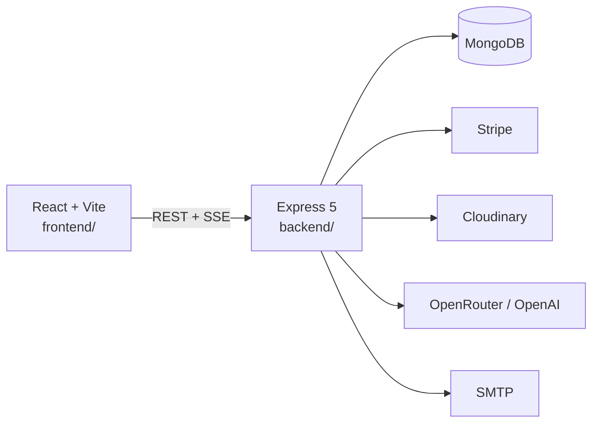

<p align="center">
  
</p>

# Howly

**A gamified, social habit tracker in the browser.** Log a day in one click, run challenges with friends, and keep a cosmic companion that grows with your streak.

Built as a university team project for [SEBA](https://www.cit.tum.de/) at the Technical University of Munich.

<p align="center">
  
</p>

## Why this project

Howly is a full-stack product, not a tutorial clone. It covers the hard parts of a real consumer app: auth, payments, moderation, realtime notifications, and a shop economy on top of daily habit tracking.

## Features

- **Habits & streaks** — custom habits, check-ins, streak shields, and a repair window after a missed day
- **Social layer** — friends, picture stories, reactions, ghost mode, blocking, and reports
- **Challenges** — invite friends, track shared goals, and get recommendations
- **Companion & shop** — earn coins, buy items, and dress a wolf / panda / bear companion
- **Premium** — Stripe subscriptions unlock higher limits, coins, and shop items
- **AI coaching** — OpenRouter-backed habit suggestions with prompt-injection and safety guards
- **Analytics** — personal stats plus anonymized community trends
- **Safety** — JWT auth, Helmet, content moderation, unsigned webhook rejection, account deletion that cancels Stripe

## Tech stack

| Layer | Stack |
| --- | --- |
| Frontend | React 19, Vite, React Router, Tailwind CSS 4, Radix / shadcn-style UI |
| Backend | Node.js, Express 5, Mongoose |
| Database | MongoDB |
| Auth | JWT, bcrypt, email verification |
| Payments | Stripe Checkout + webhooks |
| Media | Cloudinary, Sharp, Multer |
| AI | OpenRouter (GPT-4o-mini + free fallbacks), OpenAI moderation |
| Infra | Docker Compose |

## Architecture



| Area | Backend | Frontend |
| --- | --- | --- |
| Auth & profile | `src/features/auth`, `src/features/users` | Login, register, verify, profile |
| Habits & analytics | `src/features/habits`, `analytics`, `trends` | Dashboard, analytics, trends |
| Social | `src/features/social`, `stories`, `reports` | Social feed, stories, friends |
| Challenges | `src/features/challenges` | Challenges |
| Economy | `items`, `inventory`, `streakFreeze`, `payment` | Shop, inventory, premium |
| Companion | `src/features/companion`, `src/ai` | Companion onboarding + chat |

## Repository layout

```
howly/
├── frontend/          # React SPA
├── backend/           # Express API
├── docker-compose.yml       # local development
├── docker-compose.prod.yml  # public deployment
├── render.yaml
├── docs/
└── README.md
```

Frontend and backend were originally separate GitLab repos. This repository merges both with `git subtree`, so commit history from each side is preserved.

## Quick start

### Docker

```bash
git clone https://github.com/gergetrump/howly.git
cd howly
docker compose up --build
```

- App: http://localhost:5173
- API: http://localhost:3000

Core tracking works without extra keys. Stripe, Cloudinary, AI suggestions, and email stay off until you add them to the environment.

### Local (two terminals)

Requires Node.js 20+ and MongoDB on `mongodb://127.0.0.1:27017/howly`.

```bash
# backend
cd backend
cp .env.example .env
npm install
npm run dev

# frontend
cd frontend
npm install
npm run dev
```

From the repo root you can also run `npm run dev:backend` and `npm run dev:frontend`.

```bash
cd backend && npm test
```

## Deploy

People use one HTTPS site. That site serves the built React app and proxies `/api` and `/uploads` to the API, so the browser stays on one origin. Run **one** API instance. The daily streak job lives in that process and would run twice if you scale it out.

Before anyone can sign up:

- MongoDB is reachable (`MONGO_URI`).
- `JWT_SECRET` is a unique random value, at least 32 characters (`openssl rand -hex 32`). Production refuses the placeholder secret.
- Email works. Set `DISABLE_EMAIL_SENDING=false` and fill in `SMTP_*`. Login rejects unverified accounts, and a failed verification email deletes the new user.
- `SERVER_BASE_URL` and `FRONTEND_BASE_URL` are both the public `https://` URL of the site. Verification links and default avatars are opened in the browser, so they use that URL.

Stripe, Cloudinary, and OpenRouter can stay empty. Premium checkout, photo uploads, and AI coaching stay off until those keys exist.

### One machine

```bash
cp backend/.env.example backend/.env
# set JWT_SECRET, SMTP_*, and DISABLE_EMAIL_SENDING=false

cp .env.example .env
# set PUBLIC_URL=https://howly.example.com and HTTP_PORT=80

docker compose -f docker-compose.prod.yml up --build -d
```

Without a domain, leave `PUBLIC_URL` unset and open http://localhost:8080. Put Caddy, nginx, or the host's load balancer in front before sharing the site. MongoDB stays on the private Docker network.

### Render

`render.yaml` defines a private API and the public site. In the Render dashboard, choose **New → Blueprint** and point it at this repo. You will be asked for an Atlas `MONGO_URI` and SMTP settings. Render generates `JWT_SECRET` and wires the site URL and the private API address.

Use an instance that stays awake. A sleeping free instance drops the notification stream. Keep the API at one instance.

After the first deploy, register on the `onrender.com` URL and confirm the verification email. For a custom domain, point DNS at the `howly` service, then set `SERVER_BASE_URL` and `FRONTEND_BASE_URL` on the API to `https://your-domain`. Stripe webhooks, once you enable them, go to `https://your-domain/api/payments/webhook`.

To host the site and API on different public origins instead, build the frontend with `VITE_API_BASE_URL=https://api.example.com/api` and add that site origin to `CORS_ORIGINS`.

## Environment

Copy [`backend/.env.example`](backend/.env.example) to `backend/.env`. Nothing secret is committed.

| Variable | Purpose |
| --- | --- |
| `MONGO_URI` | MongoDB connection string |
| `JWT_SECRET` | Signing key for access tokens. Required, 32+ characters, in production |
| `TRUST_PROXY` | Set `true` when TLS terminates in front of the API |
| `CORS_ORIGINS` | Extra browser origins, comma-separated. The site URL is already allowed |
| `STRIPE_SECRET_KEY` / `STRIPE_WEBHOOK_SECRET` | Premium checkout |
| `CLOUDINARY_*` | Image uploads |
| `OPENROUTER_API_KEY` | AI habit suggestions |
| `MODERATION_API_KEY` | Text moderation |
| `SMTP_*` | Verification and password-reset email |
| `DISABLE_EMAIL_SENDING` | Defaults to `true` locally |

Frontend optional: `VITE_API_BASE_URL` (defaults to `http://localhost:3000/api`). The production image uses `/api`. Notification streams use that same value.

## Team

[George Trump](https://github.com/gergetrump), My Nguyen, Abinaya Sivaguru, and Maximilian Mittmann.

Originally developed on GitLab for a TUM SEBA course; this GitHub monorepo is the portfolio snapshot of that work.
