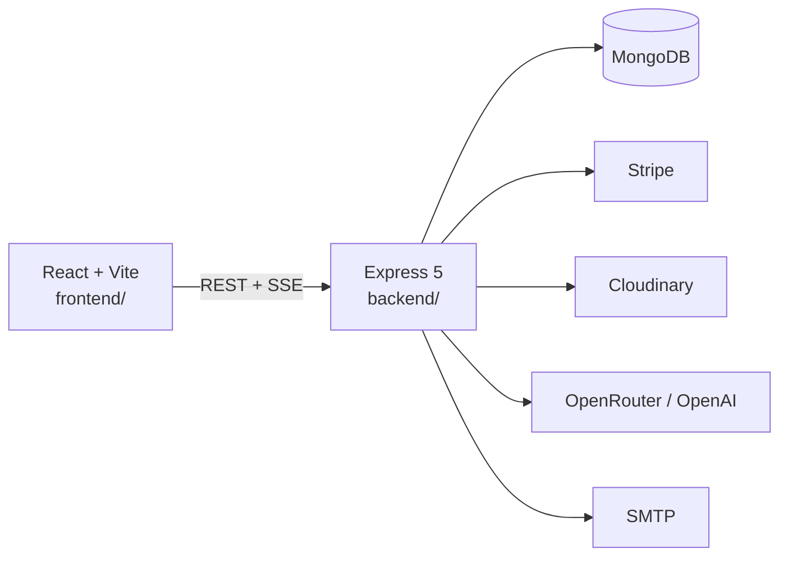

<p align="center">
  
</p>

# Howly

**A gamified, social habit tracker in the browser.** Log a day in one click, run challenges with friends, and keep a cosmic companion that grows with your streak.

Built as a university team project for [SEBA](https://www.cit.tum.de/) at the Technical University of Munich.

<p align="center">
  
</p>

## Why this project

Howly is a full-stack product, not a tutorial clone. It covers the hard parts of a real consumer app: auth, payments, moderation, realtime notifications, and a shop economy on top of daily habit tracking.

## Features

- **Habits & streaks** — custom habits, check-ins, streak shields, and a repair window after a missed day
- **Social layer** — friends, picture stories, reactions, ghost mode, blocking, and reports
- **Challenges** — invite friends, track shared goals, and get recommendations
- **Companion & shop** — earn coins, buy items, and dress a wolf / panda / bear companion
- **Premium** — Stripe subscriptions unlock higher limits, coins, and shop items
- **AI coaching** — OpenRouter-backed habit suggestions with prompt-injection and safety guards
- **Analytics** — personal stats plus anonymized community trends
- **Safety** — JWT auth, Helmet, content moderation, unsigned webhook rejection, account deletion that cancels Stripe

## Tech stack

| Layer | Stack |
| --- | --- |
| Frontend | React 19, Vite, React Router, Tailwind CSS 4, Radix / shadcn-style UI |
| Backend | Node.js, Express 5, Mongoose |
| Database | MongoDB |
| Auth | JWT, bcrypt, email verification |
| Payments | Stripe Checkout + webhooks |
| Media | Cloudinary, Sharp, Multer |
| AI | OpenRouter (GPT-4o-mini + free fallbacks), OpenAI moderation |
| Infra | Docker Compose |

## Architecture



| Area | Backend | Frontend |
| --- | --- | --- |
| Auth & profile | `src/features/auth`, `src/features/users` | Login, register, verify, profile |
| Habits & analytics | `src/features/habits`, `analytics`, `trends` | Dashboard, analytics, trends |
| Social | `src/features/social`, `stories`, `reports` | Social feed, stories, friends |
| Challenges | `src/features/challenges` | Challenges |
| Economy | `items`, `inventory`, `streakFreeze`, `payment` | Shop, inventory, premium |
| Companion | `src/features/companion`, `src/ai` | Companion onboarding + chat |

## Repository layout

```
howly/
├── frontend/          # React SPA
├── backend/           # Express API
├── docker-compose.yml       # local development
├── docker-compose.prod.yml  # public deployment
├── render.yaml
├── docs/
└── README.md
```

Frontend and backend were originally separate GitLab repos. This repository merges both with `git subtree`, so commit history from each side is preserved.

## Quick start

### Docker

```bash
git clone https://github.com/gergetrump/howly.git
cd howly
docker compose up --build
```

- App: http://localhost:5173
- API: http://localhost:3000

Core tracking works without extra keys. Stripe, Cloudinary, AI suggestions, and email stay off until you add them to the environment.

### Local (two terminals)

Requires Node.js 20+ and MongoDB on `mongodb://127.0.0.1:27017/howly`.

```bash
# backend
cd backend
cp .env.example .env
npm install
npm run dev

# frontend
cd frontend
npm install
npm run dev
```

From the repo root you can also run `npm run dev:backend` and `npm run dev:frontend`.

```bash
cd backend && npm test
```

## Deploy

People use one HTTPS site. That site serves the built React app and proxies `/api` and `/uploads` to the API. Run **one** API instance. The daily streak job lives in that process and would run twice if you scale it out.

Two Terraform roots live in `infra/`. Apply `infra/minimal`. Leave `infra/production` unapplied.

### Minimal stack

`infra/minimal` is one small EC2 instance, an Elastic IP, ports 80 and 443, SES, and Session Manager. MongoDB runs in Docker on that instance. Copy `infra/minimal/terraform.tfvars.example` to `terraform.tfvars`, then:

```bash
cd infra/minimal
terraform init
terraform apply
```

The domain already uses the Route 53 zone created when it was registered, and Terraform adds the site records there. GitHub Actions deploys `main` after tests pass once these repository variables exist: `AWS_DEPLOY_ROLE_ARN`, `AWS_REGION`, and `AWS_INSTANCE_ID`. They are the Terraform outputs. Create SES SMTP credentials after the domain verifies, put them in `smtp_username` and `smtp_password`, and apply again.

The reviewer email and password from `terraform.tfvars` are shown on the landing page and can log in without a verification mail.

### Production design

`infra/production` is the international layout: three availability zones, private subnets, CloudFront, an Application Load Balancer, one Fargate task, a three-member MongoDB replica set, and a warm standby region. Check it with `terraform validate`. Planning it requires `-var confirm_production_apply=apply-production` because an apply would start the bill.

### Local production compose

```bash
docker compose -f docker-compose.prod.yml up --build -d
```

Open http://localhost:8080. `docker-compose.https.yml` adds Caddy and is what the EC2 host runs.

## Environment

Copy [`backend/.env.example`](backend/.env.example) to `backend/.env`. Nothing secret is committed.

| Variable | Purpose |
| --- | --- |
| `MONGO_URI` | MongoDB connection string |
| `JWT_SECRET` | Signing key for access tokens. Required, 32+ characters, in production |
| `TRUST_PROXY` | Set `true` when TLS terminates in front of the API |
| `CORS_ORIGINS` | Extra browser origins, comma-separated. The site URL is already allowed |
| `STRIPE_SECRET_KEY` / `STRIPE_WEBHOOK_SECRET` | Premium checkout |
| `CLOUDINARY_*` | Image uploads |
| `OPENROUTER_API_KEY` | AI habit suggestions |
| `MODERATION_API_KEY` | Text moderation |
| `SMTP_*` | Verification and password-reset email |
| `DISABLE_EMAIL_SENDING` | Defaults to `true` locally |

Frontend optional: `VITE_API_BASE_URL` (defaults to `http://localhost:3000/api`). The production image uses `/api`. Notification streams use that same value.

## Team

[George Trump](https://github.com/gergetrump), My Nguyen, Abinaya Sivaguru, and Maximilian Mittmann.

Originally developed on GitLab for a TUM SEBA course; this GitHub monorepo is the portfolio snapshot of that work.
